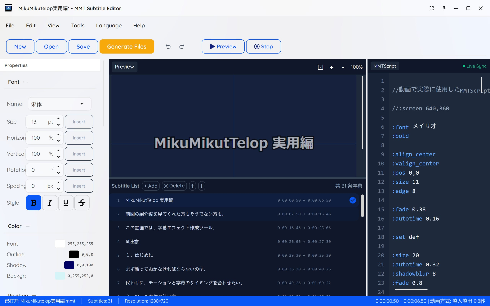
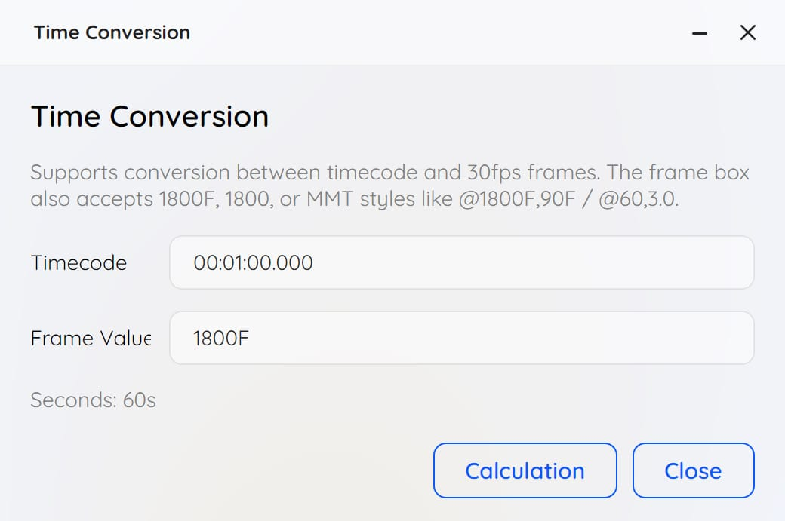
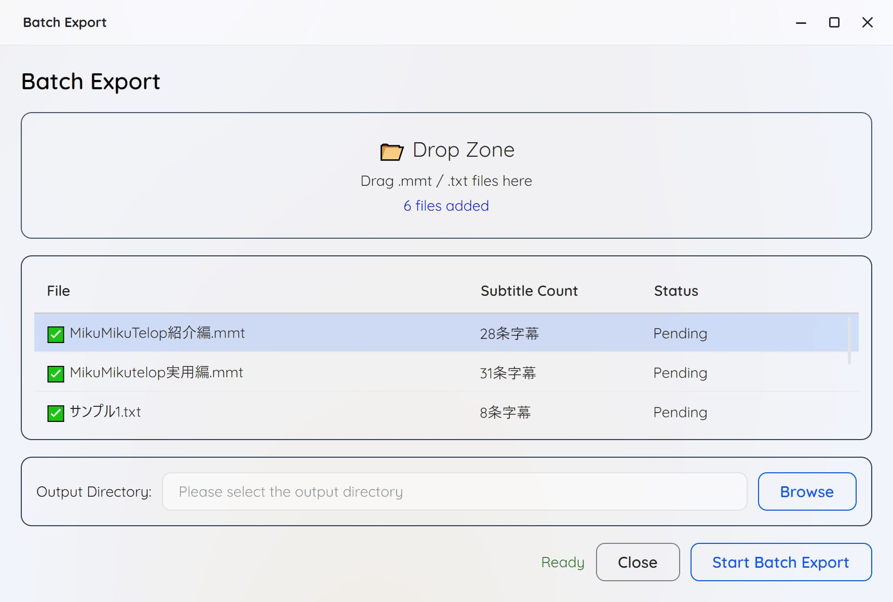
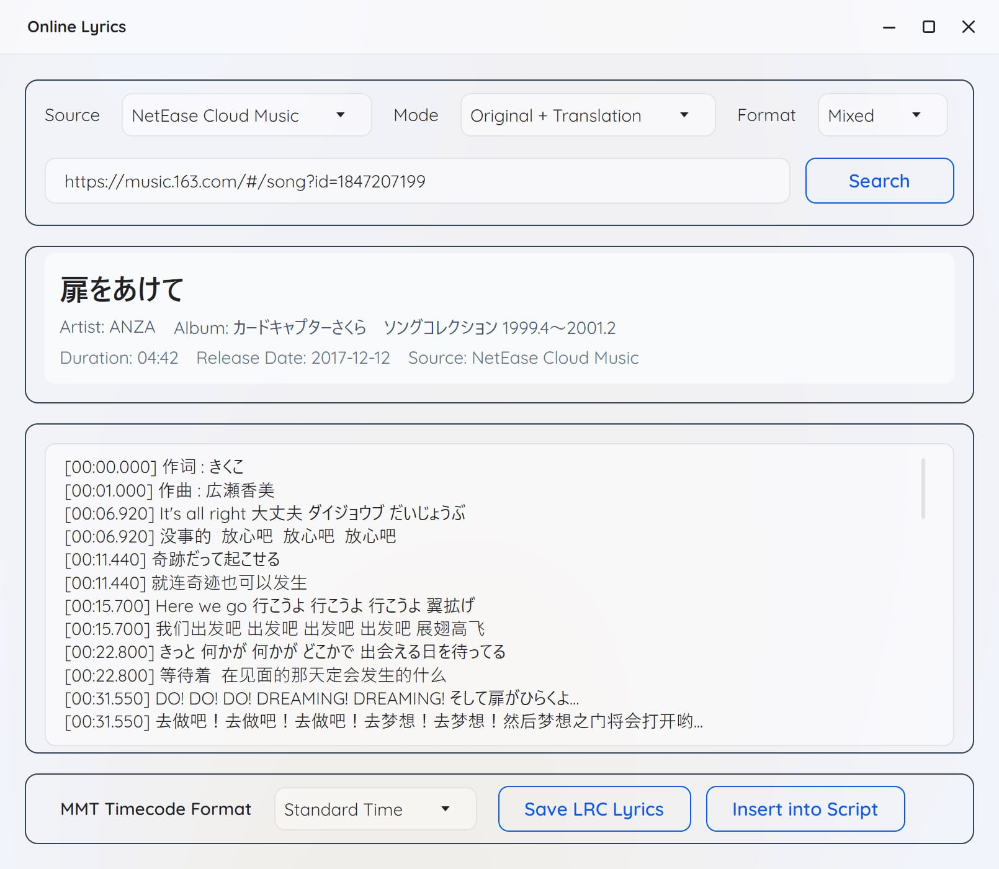
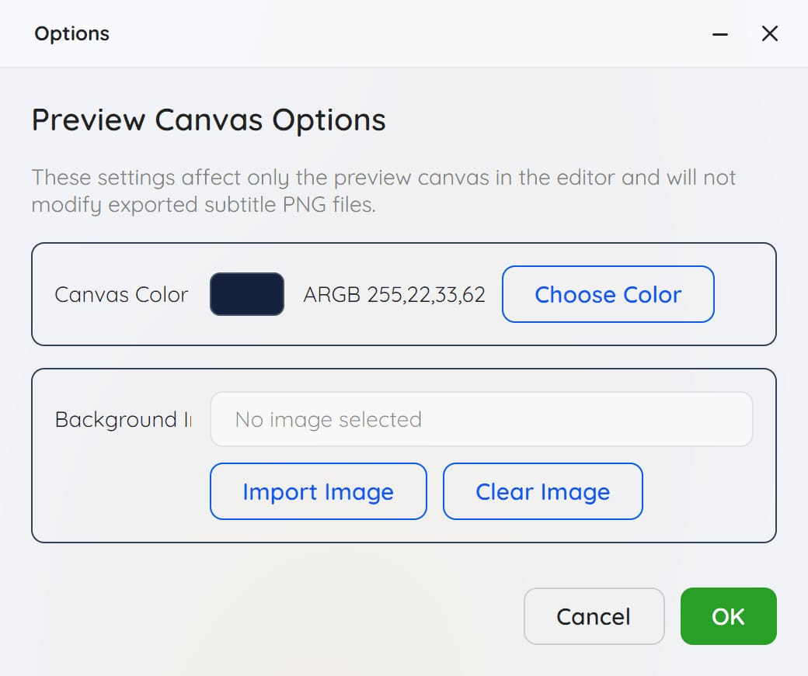

<h1 align="center">MMT Subtitle Editor</h1>

<p align="center">
  
    <br /><br />
</p>



<p align="center">
Language: <a href="HelpDoc_EN.md">English</a> | <a href="HelpDoc_SC.md">简体中文</a> | <a href="HelpDoc_TC.md">繁體中文</a> 
 | <a href="HelpDoc_JP.md">日本語</a> 

## Introduction

Based on そぼろ's MikuMikuTelop tool, MMT Subtitle Editor is a graphical tool for editing, previewing, and exporting MMTScript subtitle scripts for MMD. It simplifies subtitle creation with visualized parameters, lyric search and download, batch export, and more.

## Features

- **Script Editor**: MMTScript script editing with syntax highlighting
- **Real-time Preview**: Preview subtitle effects while editing scripts
- **Subtitle List**: Visual subtitle timeline management
- **Property Panel**: Graphical interface for quickly setting subtitle properties
- **Multi-language Support**: Supports Simplified Chinese, Traditional Chinese, English, and Japanese
- **Online Lyrics Search**: Search and import lyrics from NetEase Cloud Music and QQ Music
- **Preset Management**: Save and load subtitle style presets
- **Batch Export**: One-click export of all subtitles as PNG images
- **Timecode Conversion**: Convert between timecodes and frame numbers
- **Animation Effects**: Supports fade, random blur, slide, scale pop, wipe, blinds, and other animation effects
- **Multi-encoding Support**: Automatically detects and correctly reads UTF-8, Shift-JIS, GBK, and other encoded files

## System Requirements

- **Operating System**:
  - Windows 10/11 or later
  - macOS (10.15+)
  - Linux (Ubuntu, Debian, Fedora, Arch, etc.)
- **Runtime**: .NET 8.0 Runtime required
  - 64-bit: https://dotnet.microsoft.com/en-us/download/dotnet/thank-you/runtime-desktop-8.0.26-windows-x64-installer
  - 32-bit: https://dotnet.microsoft.com/en-us/download/dotnet/thank-you/runtime-desktop-8.0.26-windows-x86-installer
- **Resolution**: 1920×1080 or higher recommended

## How to Use

- Double-click `MMT Subtitle Editor.exe` to run the program.
- Switch to your preferred language from the "Language/语言/言語" menu. Currently available: English, Simplified Chinese, Traditional Chinese, Japanese. Let me know if you need other languages.
- Import or create `.txt/.mmt` script files
- Click the "Preview" button to play and view subtitle effects.
- Adjust parameters in the subtitle property panel, such as font, color, size, position, alignment, etc.
- Click the "Save" button to save the subtitle style as a preset.
- Click "Generate Files" to create `MikuMikuTelop.x`, `MikuMikuTelop.fx`, `PostTelop.x`, `PostTelop.fx` files and image sequences.
- Import `MikuMikuTelop.x` into MikuMikuDance for playback! The accessory should be placed at the bottom of the accessory list. Audio or frame count is required for playback.
- PostTelop.x cannot be used alone; it's designed to work with other MME effects. By hiding PostTelop.x, you can temporarily disable post-processing effects.

## Tool Menu Usage

### Time Conversion



This tool converts between timecodes and 30fps frame numbers. For example, entering `00:01:00.000` in the time field will display `1800F` in the frame field. Very convenient for calculating subtitle duration.

### Batch Export



This tool batch exports `.txt/.mmt` files, creating corresponding folders with the same names. Each folder contains image sequences and `.x/.fx` files.
Simply drag files to the drop zone.

### Online Lyrics Search



This tool searches and imports lyrics from NetEase Cloud Music and QQ Music.
First, select source, mode, and format, then enter a link or song ID. Click the search button to load lyrics. Some songs may show "no lyrics available".
Enter keywords and click search to see results. Select a song and click "OK" to import lyrics into the lyrics panel.
MMT timecode format can be set to "Timecode" or "Seconds".
The "Save Lrc Lyrics" button saves current lyrics as a `.LRC` file.
The "Insert to Script" button inserts current lyrics into the script editor.

Song link/ID examples:
NetEase Cloud example link: https://music.163.com/#/song?id=1847207199
NetEase Cloud song ID: 1847207199
QQ Music example link: https://y.qq.com/n/ryqq/songDetail/000sjEUD2wMqNt
QQ Music song ID: 000sjEUD2wMqNt

### Options



This tool sets preview canvas options.
You can set canvas color or background image.

## MMTScript Syntax Reference

MMTScript is a simple subtitle description language designed for MMD & MME subtitle effect generation tool "MikuMikuTelop".

### Basic Format

```
@display_time,duration
subtitle text
```

### Time Commands

| Format | Description |
|--------|-------------|
| `@3,5` | Display from 3 seconds for 5 seconds |
| `@100F,10` | Display from frame 100 for 10 seconds |
| `@10` | Display from 10 seconds, duration auto-calculated |
| `@+2,5` | Display 2 seconds after the previous subtitle ends |
| `@*0,5` | Display simultaneously with the previous subtitle |
| `@32~36` | Display from 32 seconds to 36 seconds |
| `@00:00:10.000 - 00:00:12.000` | Specify time range. <font color="green">*New Feature</font> |

### System Commands

#### Font Settings

| Command | Parameter | Description |
|---------|-----------|-------------|
| `:font` | font_name | Specify font name |
| `:size` | value | Font size (percentage relative to half screen height) |
| `:fontcolor` | R,G,B | Font color (0-255) |
| `:bold` | - | Enable bold |
| `:bold_off` | - | Disable bold |
| `:italic` | - | Enable italic |
| `:italic_off` | - | Disable italic |
| `:underline` | - | Enable underline |
| `:underline_off` | - | Disable underline |
| `:strikeout` | - | Enable strikethrough |
| `:strikeout_off` | - | Disable strikethrough |

#### Position Settings

| Command | Parameter | Description |
|---------|-----------|-------------|
| `:pos` | X,Y | Horizontal and vertical position (-100 to 100) |
| `:pos_x` | X | Horizontal position only |
| `:pos_y` | Y | Vertical position only |
| `:pos_nextline` | - | Move to next line |
| `:pos_next` | - | Move to continuation position |
| `:align_left` | - | Left align |
| `:align_center` | - | Center align |
| `:align_right` | - | Right align |
| `:valign_top` | - | Top align |
| `:valign_center` | - | Vertical center |
| `:valign_bottom` | - | Bottom align |

#### Stroke and Shadow

| Command | Parameter | Description |
|---------|-----------|-------------|
| `:edge` | Thickness | Stroke thickness |
| `:edgecolor` | R,G,B | Stroke color |
| `:edge2` | Thickness | Second stroke thickness <font color="green">*New Feature</font> |
| `:edgecolor2` | R,G,B | Second stroke color <font color="green">*New Feature</font> |
| `:edge3` | Thickness | Third stroke thickness <font color="green">*New Feature</font> |
| `:edgecolor3` | R,G,B | Third stroke color <font color="green">*New Feature</font> |
| `:edge4` | Thickness | Fourth stroke thickness <font color="green">*New Feature</font> |
| `:edgecolor4` | R,G,B | Fourth stroke color <font color="green">*New Feature</font> |
| `:edge_round` | - | Rounded stroke |
| `:edge_round_off` | - | Disable rounded stroke |
| `:shadow` | Distance | Shadow distance |
| `:shadowcolor` | R,G,B | Shadow color |
| `:shadowblur` | Value | Shadow blur radius |
| `:glow` | Value | Outer glow radius <font color="green">*New Feature</font> |
| `:glowcolor` | R,G,B | Outer glow color <font color="green">*New Feature</font> |
| `:glowalpha` | 0-1 | Outer glow opacity <font color="green">*New Feature</font> |
| `:edgegradient_on` | - | Enable stroke gradient <font color="green">*New Feature</font> |
| `:edgegradient_off` | - | Disable stroke gradient  <font color="green">*New Feature</font>|
| `:edgegradient` | R,G,B | Stroke gradient color  <font color="green">*New Feature</font>|
| `:textgradient_on` | - | Enable text gradient <font color="green">*New Feature</font> |
| `:textgradient_off` | - | Disable text gradient <font color="green">*New Feature</font> |
| `:textgradient` | R,G,B | Text gradient color <font color="green">*New Feature</font> |
| `:textgradientdir` | vertical/horizontal | Text gradient direction (vertical or horizontal) <font color="green">*New Feature</font> |

#### Screen Settings

| Command | Parameter | Description |
|---------|-----------|-------------|
| `:screen` | width,height | Screen dimensions |
| `:screen_height` | height | Screen height |
| `:margin` | X,Y | Margins (percentage relative to font size) |
| `:backcolor` | R,G,B,A | Background color |

#### Effect Settings

| Command | Parameter | Description |
|---------|-----------|-------------|
| `:alpha` | opacity | Opacity (0-1.0) |
| `:fade` | time | Fade in/out time (seconds) |
| `:autotime` | time | Auto duration per character (seconds) |
| `:timebase` | time | Time base |

#### Transform Settings

| Command | Parameter | Description |
|---------|-----------|-------------|
| `:scalex` | scale | Horizontal scale <font color="green">*New Feature</font> |
| `:scaley` | scale | Vertical scale <font color="green">*New Feature</font> |
| `:rotate` | angle | Rotation angle <font color="green">*New Feature</font> |
| `:spacing` | spacing | Character spacing <font color="green">*New Feature</font> |
| `:pos_z` | depth | Z-axis position <font color="green">*New Feature</font> |

#### Animation Effects

The following are new features that allow you to add various animation effects to subtitles:

| Command | Parameter | Description |
|---------|-----------|-------------|
| `:anim fade` | type | Animation type - Fade <font color="green">*New Feature</font> |
| `:anim random_blur` | type | Animation type - Random Blur <font color="green">*New Feature</font> |
| `:anim slide_up` | type | Animation type - Slide Up <font color="green">*New Feature</font> |
| `:anim scale_pop` | type | Animation type - Scale Pop <font color="green">*New Feature</font> |
| `:anim wipe` | type | Animation type - Wipe <font color="green">*New Feature</font> |
| `:anim blinds` | type | Animation type - Blinds <font color="green">*New Feature</font> |
| `:animtime` | time | Animation time (seconds) <font color="green">*New Feature</font> |
| `:animdir` | direction | Wipe direction (ltr/rtl) <font color="green">*New Feature</font> |
| `:animblinds` | count | Number of blinds <font color="green">*New Feature</font> |
| `:animblur` | intensity | Blur intensity <font color="green">*New Feature</font> |

#### Special Functions

| Command | Parameter | Description |
|---------|-----------|-------------|
| `:tate` | - | Vertical text |
| `:tate_off` | - | Disable vertical text |
| `:billboard` | - | Billboard mode |
| `:billboard_off` | - | Disable billboard mode |
| `:set` | name | Save current format as preset |
| `:get` | name | Load saved format (default resets all) |
| `:skip` | - | Skip next text command |
| `:end` | - | Script end marker |
| `:imagepath` | path/to/image.png | image path <font color="green">*New Feature</font> |
| `:imagescale` | 150,150 | Image Scale <font color="green">*New Feature</font> |
| `:imagepos` | 0,0,0 | Image Location <font color="green">*New Feature</font> |
| `:imagerotation` | value | Image rotation angle <font color="green">*New Feature</font> |
| `:imagealpha` | 0-1 | Transparency of image <font color="green">*New Feature</font> |

### Comments

```
// This is a comment line
```

### Example Script

```
// Basic settings
:screen 1280,720
:font MS Gothic
:size 48
:fontcolor 255,255,255
:edge 7
:edgecolor 0,0,0
:align_center

// First subtitle
@0,3
Welcome

// Second subtitle
@+1,3
This is an example subtitle
You can write multi-line subtitles

// Use preset
:set style1

// Load preset
:get style1

// End
:end
```

## Keyboard Shortcuts

| Shortcut | Function |
|----------|----------|
| Ctrl+N | New file |
| Ctrl+O | Open file |
| Ctrl+S | Save file |
| Ctrl+Shift+S | Save as |
| F5 | Refresh preview |
| Ctrl+E | Export PNG |
| Ctrl+P | Preset management |

## using the statute

- free to share, not commercial.
- the author is not responsible for any problems.

## License

This project is open source under the MIT license.

## Acknowledgments

- [MikuMikuTelop](https://www.nicovideo.jp/watch/sm15635052) - Original MMTScript specification designer: そぼろ
- [Avalonia](https://avaloniaui.net/) - Cross-platform UI framework
- [SukiUI](https://github.com/kikipoulet/SukiUI) - Modern UI theme
- [163MusicLyrics](https://github.com/jitwxs/163MusicLyrics) - Online lyrics reference project            
  
## AI Assistance

- GLM 5.1
- GPT-5.4
