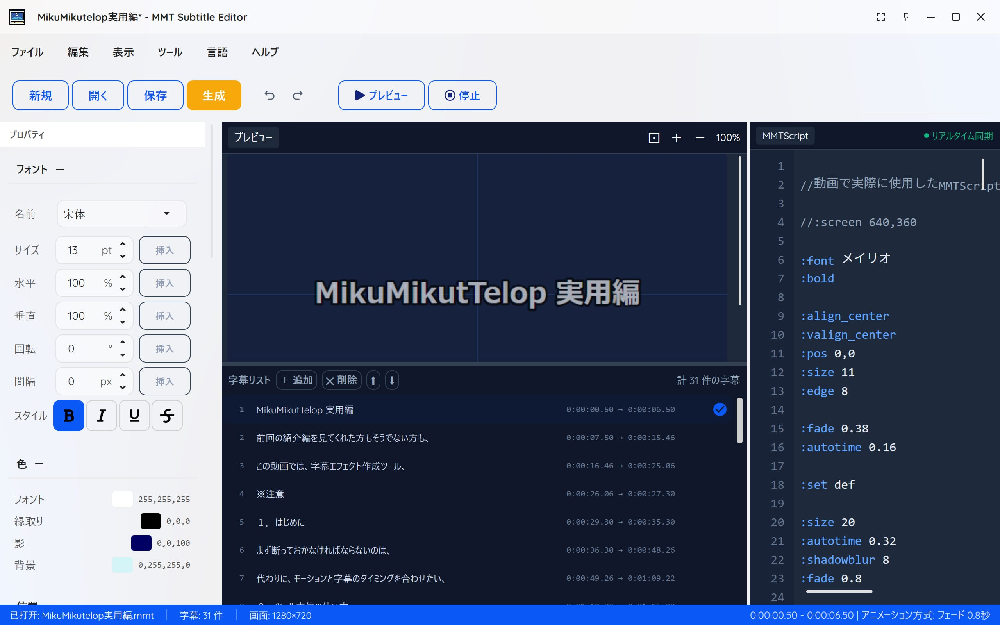
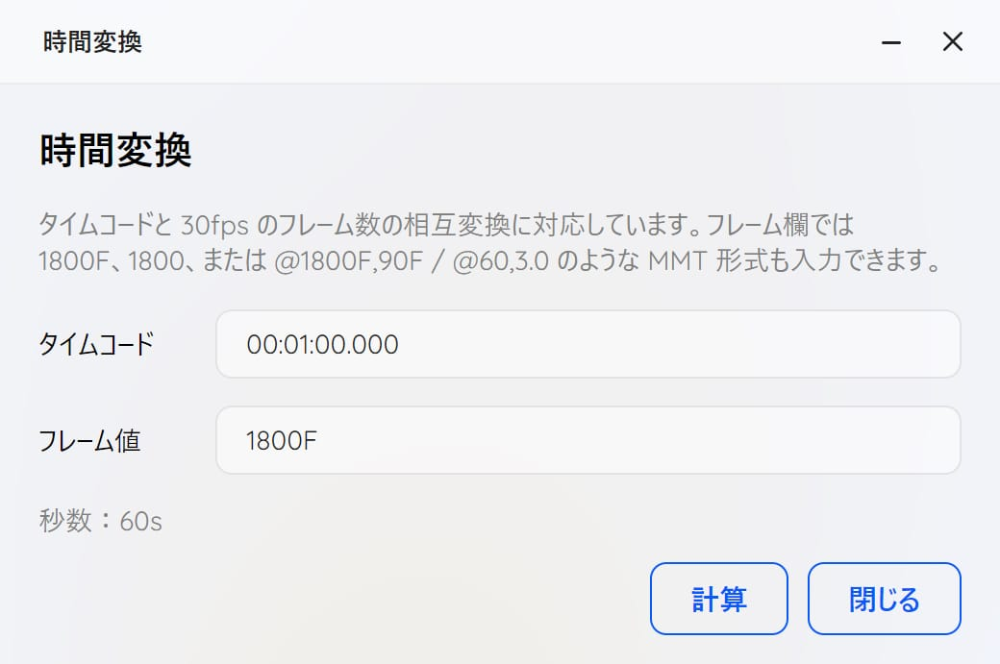
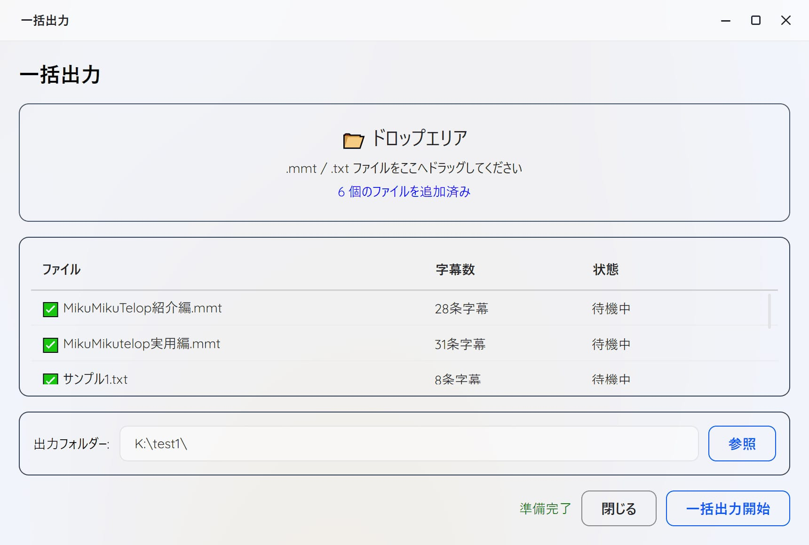
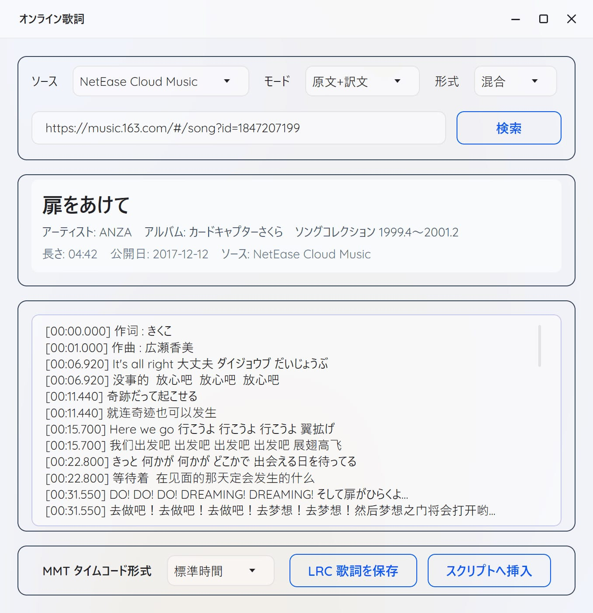
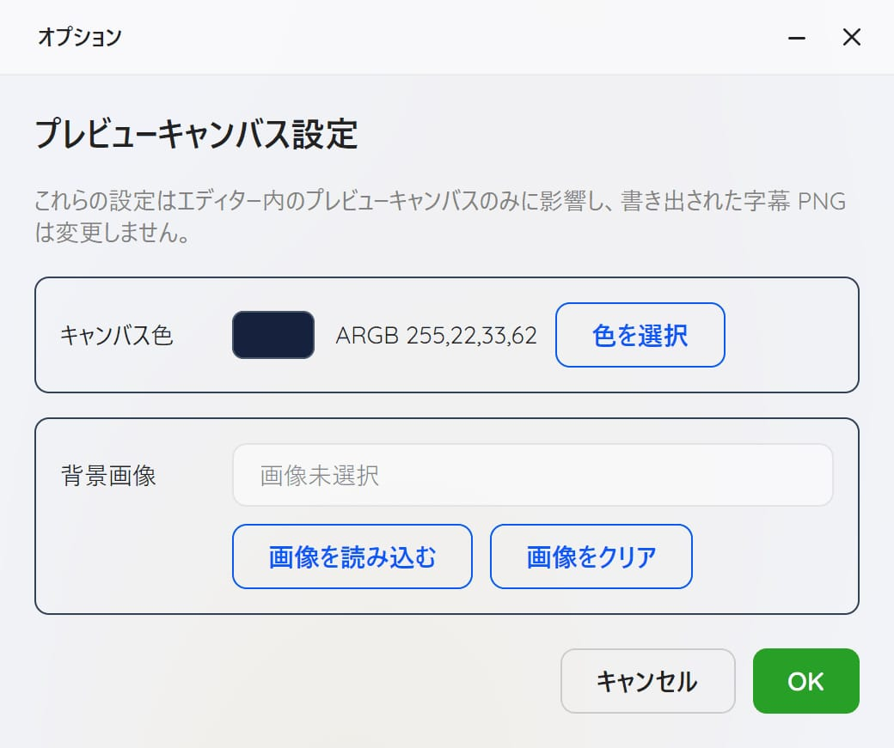

<h1 align="center">MMT Subtitle Editor</h1>

<p align="center">
  
    <br /><br />
    <a href="LICENSE"></a>
    <a href="https://github.com/SaraKale/MMT_Subtitle_Editor/releases"></a>
    <a href=""></a>
    <a href=""></a>
</p>



<p align="center">
言語：<a href="README.md">English</a> | <a href="README_SC.md">简体中文</a> | <a href="README_TC.md">繁體中文</a> 
 | <a href="README_JP.md">日本語</a> 

## 紹介

そぼろ氏のMikuMikuTelopツールをベースに、MMT Subtitle EditorはMMD用MMTScript字幕スクリプトを編集、プレビュー、エクスポートするためのグラフィカルツールです。パラメータの可視化、歌詞検索・ダウンロード、一括エクスポートなど、字幕作成を簡単に行えます。

## 機能

- **スクリプトエディタ**：シンタックスハイライト対応のMMTScriptスクリプト編集
- **リアルタイムプレビュー**：スクリプト編集中に字幕効果をリアルタイムプレビュー
- **字幕リスト**：視覚的な字幕タイムライン管理
- **プロパティパネル**：グラフィカルインターフェースで字幕プロパティを素早く設定
- **多言語対応**：簡体字中国語、繁体字中国語、英語、日本語に対応
- **オンライン歌詞検索**：網易雲音楽、QQ音乐から歌詞を検索・インポート
- **プリセット管理**：字幕スタイルプリセットの保存と読み込み
- **一括エクスポート**：全字幕をPNG画像として一括エクスポート
- **タイムコード変換**：タイムコードとフレーム番号の相互変換
- **アニメーション効果**：フェード、ランダムブラー、スライド、スケールポップ、ワイプ、ブラインドなどのアニメーション効果に対応
- **マルチエンコーディング対応**：UTF-8、Shift-JIS、GBKなど、エンコーディングを自動検出して正しく読み込み

## 動作環境

- **オペレーティングシステム**：
  - Windows 10/11以降
  - macOS (10.15+)
  - Linux (Ubuntu, Debian, Fedora, Archなど)
- **ランタイム**：.NET 8.0 Runtimeが必要
  - 64ビット：https://dotnet.microsoft.com/ja-jp/download/dotnet/thank-you/runtime-desktop-8.0.26-windows-x64-installer
  - 32ビット：https://dotnet.microsoft.com/ja-jp/download/dotnet/thank-you/runtime-desktop-8.0.26-windows-x86-installer
- **解像度**：1920×1080以上を推奨

## 使い方

- `MMT Subtitle Editor.exe`をダブルクリックして実行します。
- メニューバーの「Language/语言/言語」からお好みの言語に切り替えられます。現在、英語、簡体字中国語、繁体字中国語、日本語に対応しています。他の言語が必要な場合はお知らせください。
- `.txt/.mmt`スクリプトファイルをインポートまたは作成
- 「プレビュー」ボタンをクリックして字幕効果を再生・確認します。
- 字幕プロパティパネルでフォント、色、サイズ、位置、配置などのパラメータを調整します。
- 「保存」ボタンをクリックして字幕スタイルをプリセットとして保存します。
- 「ファイル生成」をクリックすると、`MikuMikuTelop.x`、`MikuMikuTelop.fx`、`PostTelop.x`、`PostTelop.fx`の4つのファイルと画像シーケンスが生成されます。
- `MikuMikuTelop.x`をMikuMikuDanceにインポートして再生します！アクセサリはアクセサリリストの一番下に配置する必要があります。再生するには、オーディオまたはフレーム数が必要です。
- PostTelop.xは単体では使用できません。他のMMEエフェクトと組み合わせて使用するためのものです。PostTelop.xを非表示にすることで、ポストエフェクトを一時的に無効化できます。

## ツールメニューの使い方

### 時間変換



タイムコードと30fpsフレーム番号を相互変換するツールです。例えば、時間欄に`00:01:00.000`と入力すると、フレーム欄に`1800F`と表示されます。字幕の長さを計算するのに便利です。

### 一括エクスポート



`.txt/.mmt`ファイルを一括エクスポートするツールです。同名のフォルダが作成され、各フォルダには画像シーケンスと`.x/.fx`ファイルが含まれます。
ファイルをドロップゾーンにドラッグするだけです。

### オンライン歌詞検索



網易雲音楽、QQ音乐から歌詞を検索・インポートするツールです。
まず、ソース、モード、形式を選択し、リンクまたは曲IDを入力して検索ボタンをクリックすると、歌詞が読み込まれます。一部の曲では歌詞がない場合があります。
キーワードを入力して検索ボタンをクリックすると、検索結果が表示されます。曲を選択して「OK」ボタンをクリックすると、歌詞が歌詞パネルにインポートされます。
MMTタイムコードフォーマットでは「タイムコード」または「秒数」を選択できます。
「Lrc歌詞を保存」ボタンで現在の歌詞を`.LRC`ファイルとして保存できます。
「スクリプトに挿入」ボタンで現在の歌詞をスクリプトエディタに挿入できます。

曲リンク/曲IDの例：
網易雲音楽の例：https://music.163.com/#/song?id=1847207199
網易雲音楽の曲ID：1847207199
QQ音乐の例：https://y.qq.com/n/ryqq/songDetail/000sjEUD2wMqNt
QQ音乐の曲ID：000sjEUD2wMqNt

### オプション



プレビューキャンバスのオプションを設定するツールです。
キャンバスの色または背景画像を設定できます。

## MMTScript構文リファレンス

MMTScriptはMMD & MME字幕エフェクト生成ツール「MikuMikuTelop」用に設計されたシンプルな字幕記述言語です。

### 基本形式

```
@表示時間,表示時間
字幕テキスト
```

### 時間コマンド

| 形式 | 説明 |
|------|------|
| `@3,5` | 3秒から5秒間表示 |
| `@100F,10` | 100フレームから10秒間表示 |
| `@10` | 10秒から表示、時間は自動計算 |
| `@+2,5` | 前の字幕終了後2秒から表示 |
| `@*0,5` | 前の字幕と同時に表示 |
| `@32~36` | 32秒から36秒まで表示 |
| `@00:00:10.000 - 00:00:12.000` | 時間範囲を指定。<font color="green">*新機能</font> |

### システムコマンド

#### フォント設定

| コマンド | パラメータ | 説明 |
|----------|------------|------|
| `:font` | フォント名 | フォント名を指定 |
| `:size` | 数値 | フォントサイズ（画面高さの半分に対するパーセンテージ） |
| `:fontcolor` | R,G,B | フォントカラー（0-255） |
| `:bold` | - | 太字を有効 |
| `:bold_off` | - | 太字を無効 |
| `:italic` | - | イタリックを有効 |
| `:italic_off` | - | イタリックを無効 |
| `:underline` | - | 下線を有効 |
| `:underline_off` | - | 下線を無効 |
| `:strikeout` | - | 取り消し線を有効 |
| `:strikeout_off` | - | 取り消し線を無効 |

#### 位置設定

| コマンド | パラメータ | 説明 |
|----------|------------|------|
| `:pos` | X,Y | 水平・垂直位置（-100から100） |
| `:pos_x` | X | 水平位置のみ |
| `:pos_y` | Y | 垂直位置のみ |
| `:pos_nextline` | - | 次の行に移動 |
| `:pos_next` | - | 継続位置に移動 |
| `:align_left` | - | 左揃え |
| `:align_center` | - | 中央揃え |
| `:align_right` | - | 右揃え |
| `:valign_top` | - | 上揃え |
| `:valign_center` | - | 垂直中央 |
| `:valign_bottom` | - | 下揃え |

#### 縁取りとシャドウ

| コマンド | パラメータ | 説明 |
|----------|------------|------|
| `:edge` | 太さ | 縁取りの太さ（フォントサイズに対するパーセンテージ） |
| `:edgecolor` | R,G,B | 縁取りカラー |
| `:edge_round` | - | 丸い縁取り |
| `:edge_round_off` | - | 丸い縁取りを無効 |
| `:shadow` | 距離 | シャドウ距離（フォントサイズに対するパーセンテージ） |
| `:shadowcolor` | R,G,B | シャドウカラー |
| `:shadowblur` | 半径 | シャドウブラー半径 |

#### 画面設定

| コマンド | パラメータ | 説明 |
|----------|------------|------|
| `:screen` | 幅,高さ | 画面サイズ |
| `:screen_height` | 高さ | 画面の高さ |
| `:margin` | X,Y | マージン（フォントサイズに対するパーセンテージ） |
| `:backcolor` | R,G,B,A | 背景色 |

#### エフェクト設定

| コマンド | パラメータ | 説明 |
|----------|------------|------|
| `:alpha` | 不透明度 | 不透明度（0-1.0） |
| `:fade` | 時間 | フェードイン/アウト時間（秒） |
| `:autotime` | 時間 | 1文字あたりの自動時間（秒） |
| `:timebase` | 時間 | タイムベース |

#### 変形設定

| コマンド | パラメータ | 説明 |
|----------|------------|------|
| `:scalex` | 倍率 | 水平スケール <font color="green">*新機能</font> |
| `:scaley` | 倍率 | 垂直スケール <font color="green">*新機能</font> |
| `:rotate` | 角度 | 回転角度 <font color="green">*新機能</font> |
| `:spacing` | 間隔 | 文字間隔  <font color="green">*新機能</font>|
| `:pos_z` | 深度 | Z軸位置  <font color="green">*新機能</font> |

#### アニメーション効果

以下は新機能で、字幕に様々なアニメーション効果を追加できます：

| コマンド | パラメータ | 説明 |
|----------|------------|------|
| `:anim fade` | タイプ | アニメーションタイプ - フェード <font color="green">*新機能</font> |
| `:anim random_blur` | タイプ | アニメーションタイプ - ランダムブラー <font color="green">*新機能</font> |
| `:anim slide_up` | タイプ | アニメーションタイプ - スライドアップ <font color="green">*新機能</font> |
| `:anim scale_pop` | タイプ | アニメーションタイプ - スケールポップ <font color="green">*新機能</font> |
| `:anim wipe` | タイプ | アニメーションタイプ - ワイプ <font color="green">*新機能</font> |
| `:anim blinds` | タイプ | アニメーションタイプ - ブラインド <font color="green">*新機能</font> |
| `:animtime` | 時間 | アニメーション時間（秒）<font color="green">*新機能</font> |
| `:animdir` | 方向 | ワイプ方向（ltr/rtl）<font color="green">*新機能</font> |
| `:animblinds` | 数 | ブラインドの数 <font color="green">*新機能</font> |
| `:animblur` | 強度 | ブラース強度 <font color="green">*新機能</font> |

#### 特殊機能

| コマンド | パラメータ | 説明 |
|----------|------------|------|
| `:tate` | - | 縦書き |
| `:tate_off` | - | 縦書きを無効 |
| `:billboard` | - | ビルボードモード |
| `:billboard_off` | - | ビルボードモードを無効 |
| `:set` | 名前 | 現在のフォーマットをプリセットとして保存 |
| `:get` | 名前 | 保存したフォーマットを呼び出し（defaultで全リセット） |
| `:skip` | - | 次のテキストコマンドをスキップ |
| `:end` | - | スクリプト終了マーク |

### コメント

```
// これはコメント行です
```

### サンプルスクリプト

```
// 基本設定
:screen 1280,720
:font MS Gothic
:size 48
:fontcolor 255,255,255
:edge 7
:edgecolor 0,0,0
:align_center

// 最初の字幕
@0,3
ようこそ

// 2番目の字幕
@+1,3
これはサンプル字幕です
複数行の字幕を書けます

// プリセットを使用
:set style1

// プリセットを呼び出し
:get style1

// 終了
:end
```

## キーボードショートカット

| ショートカット | 機能 |
|----------------|------|
| Ctrl+N | 新規ファイル |
| Ctrl+O | ファイルを開く |
| Ctrl+S | ファイルを保存 |
| Ctrl+Shift+S | 名前を付けて保存 |
| F5 | プレビューを更新 |
| Ctrl+E | PNGエクスポート |
| Ctrl+P | プリセット管理 |

## ビルド

### 前提条件

1. [.NET 8.0 SDK](https://dotnet.microsoft.com/download/dotnet/8.0)をインストール
2. Visual Studio 2022またはJetBrains Riderをインストール

### ビルド手順

```bash
# プロジェクトをクローン
git clone https://github.com/SaraKale/MMT_Subtitle_Editor.git
```

プロジェクトの依存関係（NuGetパッケージ）：

```xml
dotnet add package Avalonia -v 11.3.4
dotnet add package Avalonia.Desktop -v 11.3.4
dotnet add package Avalonia.Diagnostics -v 11.3.4
dotnet add package Avalonia.Fonts.Inter -v 11.3.4
dotnet add package Avalonia.Themes.Fluent -v 11.3.4
dotnet add package AvaloniaEdit.TextMate -v 11.4.0
dotnet add package CommunityToolkit.Mvvm -v 8.4.2
dotnet add package SukiUI -v 6.0.3
dotnet add package Svg.Controls.Skia.Avalonia -v 11.3.0
dotnet add package System.Text.Encoding.CodePages -v 8.0.0
```

`MMT Subtitle Editor.sln`を開いてビルドしてください。

または**dotnet**でビルド：
```
dotnet publish -c Release -r win-x64
dotnet publish -c Release -r osx-x64
dotnet publish -c Release -r osx-arm64
dotnet publish -c Release -r linux-x64
```

または`BatchBuild.bat`をクリックしてマルチプラットフォーム版を一括ビルド。

## 使用規約

- このプログラムは自由に共有でき、商用には使用できません。
- 作成者は、生じた問題について一切の責任を負いません。

## ライセンス

このプロジェクトはCC BY-NC-SA 4.0ライセンスで公開されています。

## 謝辞

- [MikuMikuTelop](https://www.nicovideo.jp/watch/sm15635052) - オリジナルMMTScript仕様設計者：そぼろ
- [Avalonia](https://avaloniaui.net/) - クロスプラットフォームUIフレームワーク
- [SukiUI](https://github.com/kikipoulet/SukiUI) - モダンUIテーマ
- [163MusicLyrics](https://github.com/jitwxs/163MusicLyrics) - オンライン歌詞参考プロジェクト            
  
## AIアシスタント

- GLM 5.1
- GPT-5.4
