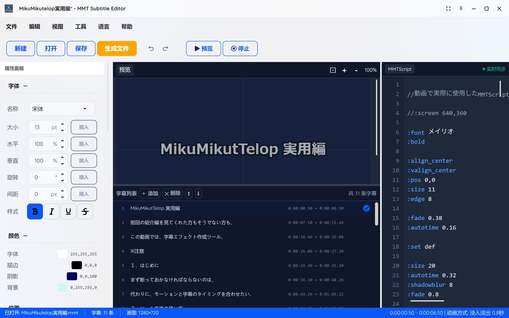
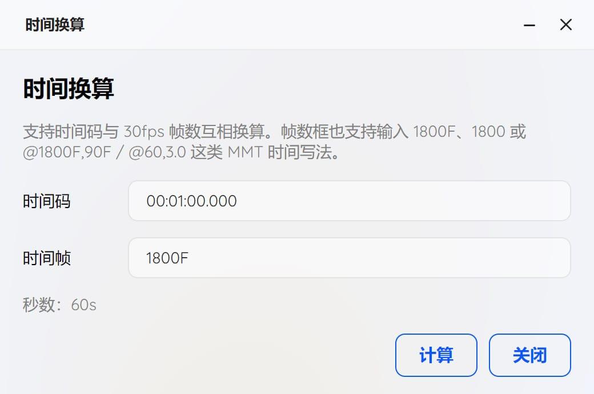
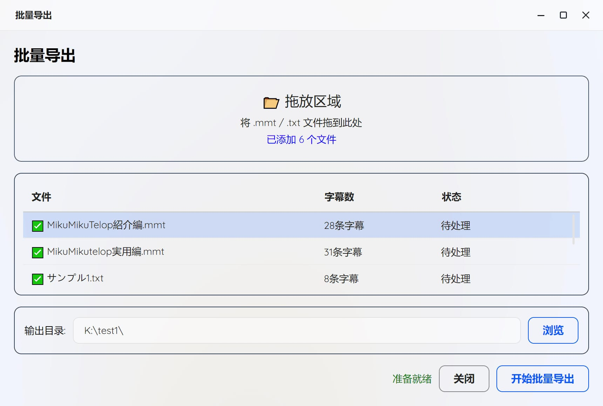
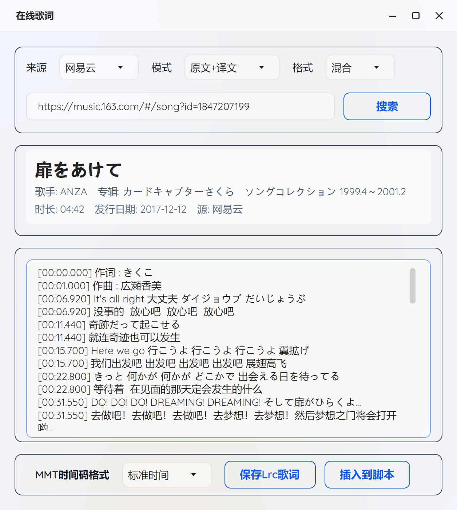

<h1 align="center">MMT Subtitle Editor</h1>

<p align="center">
  
    <br /><br />
    <a href="LICENSE"></a>
    <a href="https://github.com/SaraKale/MMT_Subtitle_Editor/releases"></a>
    <a href=""></a>
    <a href=""></a>
</p>



<p align="center">
語言：<a href="README.md">English</a> | <a href="README_SC.md">简体中文</a> | <a href="README_TC.md">繁體中文</a> 
 | <a href="README_JP.md">日文</a> 

## 介紹

基於 そぼろ 作者 MikuMikuTelop 工具修改，MMT Subtitle Editor 是一個用於編輯、預覽和匯出MMD專用的MMTScript字幕腳本圖形化工具。方便編輯創建字幕，實現簡單化操作，參數可視化，歌詞搜尋下載、批量匯出等。

## 功能特點

- **腳本編輯器**：支援語法高亮的 MMTScript 腳本編輯
- **即時預覽**：編輯腳本時即時預覽字幕效果
- **字幕列表**：可視化字幕時間軸管理
- **屬性面板**：圖形化介面快速設定字幕屬性
- **多語言支援**：支援簡體中文、繁體中文、英文、日文
- **線上歌詞搜尋**：支援從網易雲音樂、QQ音樂搜尋並匯入歌詞
- **預設管理**：儲存和載入字幕樣式預設
- **批量匯出**：一鍵匯出所有字幕為 PNG 圖片
- **時間碼轉換**：支援時間碼與幀數互相換算
- **動畫效果**：支援淡入淡出、隨機模糊、滑動、縮放、擦除、百葉窗等動畫效果
- **多編碼支援**：自動檢測並正確讀取 UTF-8、Shift-JIS、GBK 等編碼檔案

## 系統要求

- **作業系統**：
  - Windows 10/11 以上系統
  - macOS (10.15+)
  - Linux (Ubuntu, Debian, Fedora, Arch 等)
- **運行時**：需要安裝 .NET 8.0 Runtime
  - 64位元：https://dotnet.microsoft.com/zh-cn/download/dotnet/thank-you/runtime-desktop-8.0.26-windows-x64-installer
  - 32位元：https://dotnet.microsoft.com/en-us/download/dotnet/thank-you/runtime-desktop-8.0.26-windows-x86-installer
- **解析度**：建議 1920×1080 或更高

## 使用方法

- 雙擊運行 `MMT Subtitle Editor.exe` 程式即可。
- 在選單列「Language/語言/言語」可以切換你喜歡的語言。目前有：英語、簡體中文、繁體中文、日語，如需要其他語言請告知我，我會添加上。
- 匯入或創建 `.txt/.mmt` 腳本檔案
- 點擊「預覽」按鈕播放查看字幕效果。
- 調整字幕屬性面板中的參數，如字體、顏色、大小、位置、對齊方式等。
- 點擊「儲存」按鈕將字幕樣式儲存為預設。
- 點擊「生成檔案」將生成 `MikuMikuTelop.x`、`MikuMikuTelop.fx`、`PostTelop.x`、`PostTelop.fx`四個檔案和圖片序列。
- 匯入`MikuMikuTelop.x` 到 MikuMikudance 進行播放！附件順序需要放置到附件最底部。需要有音頻或幀數才能播放。
- PostTelop.x 不能單獨使用，它是作為可以和其他MME受影響使用。通過隱藏PostTelop.x，可以暫時解除後效果化。

## 工具選單使用

### 時間換算



這是用於時間碼與 30fps 幀數互相換算。比如在時間輸入`00:01:00.000`，幀數框會顯示`1800F`。很方便計算字幕時長。

### 批量匯出



這是用於批量將 `.txt/.mmt` 檔案匯出，將會匯出對應的同名資料夾，每個資料夾內有圖片序列和`.x/.fx`檔案。
直接拖動檔案到拖放區域即可。

### 線上歌詞搜尋



這是用於從網易雲音樂、QQ音樂搜尋並匯入歌詞。
首先選擇來源、模式、格式後，輸入連結、歌曲ID，點擊搜尋按鈕，將會讀取到歌詞，有些歌曲會提示可能沒有歌詞。
輸入關鍵字後，點擊搜尋按鈕，將會彈出搜尋結果，選擇對應的歌曲後點擊「確定」按鈕即可將歌詞匯入到歌詞面板中。
MMT時間碼格式可以選擇「時間碼」或「秒數」。
「儲存Lrc歌詞」按鈕可以將當前歌詞儲存為 `.LRC` 檔案。
「插入到腳本」按鈕可以將當前歌詞插入到腳本編輯器中。

歌曲連結/歌曲ID範例：
網易雲範例連結：https://music.163.com/#/song?id=1847207199
網易雲歌曲ID：1847207199
QQ音樂範例連結：https://y.qq.com/n/ryqq/songDetail/000sjEUD2wMqNt
QQ音樂歌曲ID：000sjEUD2wMqNt

### 選項


這是用於設定預覽畫布選項。
可以設定畫布顏色或背景圖片。

## MMTScript 語法參考

MMTScript 是為 MMD & MME 字幕特效生成工具「MikuMikuTelop」設計的簡易字幕描述語言。

### 基本格式

```
@顯示時間,顯示時長
字幕文本
```

### 時間命令

| 格式 | 說明 |
|------|------|
| `@3,5` | 從3秒開始顯示5秒 |
| `@100F,10` | 從100幀開始顯示10秒 |
| `@10` | 從10秒開始，時長自動計算 |
| `@+2,5` | 在前一個字幕後2秒開始 |
| `@*0,5` | 與前一個字幕同時開始 |
| `@32~36` | 從32秒顯示到36秒 |
| `@00:00:10.000 - 00:00:12.000` | 指定時間範圍。<font color="green">*新增功能</font> |

### 系統命令

#### 字體設定

| 命令 | 參數 | 說明 |
|------|------|------|
| `:font` | 字體名 | 指定字體名稱 |
| `:size` | 數值 | 字體大小（相對於螢幕高度一半的百分比） |
| `:fontcolor` | R,G,B | 字體顏色（0-255） |
| `:bold` | - | 開啟粗體 |
| `:bold_off` | - | 關閉粗體 |
| `:italic` | - | 開啟斜體 |
| `:italic_off` | - | 關閉斜體 |
| `:underline` | - | 開啟底線 |
| `:underline_off` | - | 關閉底線 |
| `:strikeout` | - | 開啟刪除線 |
| `:strikeout_off` | - | 關閉刪除線 |

#### 位置設定

| 命令 | 參數 | 說明 |
|------|------|------|
| `:pos` | X,Y | 水平和垂直位置（-100到100） |
| `:pos_x` | X | 僅水平位置 |
| `:pos_y` | Y | 僅垂直位置 |
| `:pos_nextline` | - | 移動到下一行 |
| `:pos_next` | - | 移動到延續位置 |
| `:align_left` | - | 靠左對齊 |
| `:align_center` | - | 置中對齊 |
| `:align_right` | - | 靠右對齊 |
| `:valign_top` | - | 頂部對齊 |
| `:valign_center` | - | 垂直置中 |
| `:valign_bottom` | - | 底部對齊 |

#### 描邊和陰影

| 命令 | 參數 | 說明 |
|------|------|------|
| `:edge` | 粗細 | 描邊粗細（相對於字體大小的百分比） |
| `:edgecolor` | R,G,B | 描邊顏色 |
| `:edge_round` | - | 圓角描邊 |
| `:edge_round_off` | - | 關閉圓角描邊 |
| `:shadow` | 距離 | 陰影距離（相對於字體大小的百分比） |
| `:shadowcolor` | R,G,B | 陰影顏色 |
| `:shadowblur` | 半徑 | 陰影模糊半徑 |

#### 畫面設定

| 命令 | 參數 | 說明 |
|------|------|------|
| `:screen` | 寬,高 | 畫面尺寸 |
| `:screen_height` | 高度 | 畫面高度 |
| `:margin` | X,Y | 邊距（相對於字體大小的百分比） |
| `:backcolor` | R,G,B,A | 背景顏色 |

#### 效果設定

| 命令 | 參數 | 說明 |
|------|------|------|
| `:alpha` | 透明度 | 不透明度（0-1.0） |
| `:fade` | 時間 | 淡入淡出時間（秒） |
| `:autotime` | 時間 | 每字符自動時長（秒） |
| `:timebase` | 時間 | 時間基準 |

#### 變換設定

| 命令 | 參數 | 說明 |
|------|------|------|
| `:scalex` | 比例 | 水平縮放 <font color="green">*新增功能</font> |
| `:scaley` | 比例 | 垂直縮放 <font color="green">*新增功能</font> |
| `:rotate` | 角度 | 旋轉角度 <font color="green">*新增功能</font> |
| `:spacing` | 間距 | 字符間距 <font color="green">*新增功能</font> |
| `:pos_z` | 深度 | Z軸位置 <font color="green">*新增功能</font> |

#### 動畫效果

以下功能是新增的，可以通過這些命令為字幕添加各種動畫效果：

| 命令 | 參數 | 說明 |
|------|------|------|
| `:anim fade` | 類型 | 動畫類型-淡入淡出 <font color="green">*新增功能</font> |
| `:anim random_blur` | 類型 | 動畫類型-隨機模糊 <font color="green">*新增功能</font> |
| `:anim slide_up` | 類型 | 動畫類型-上滑進入 <font color="green">*新增功能</font> |
| `:anim scale_pop` | 類型 | 動畫類型-縮放彈出 <font color="green">*新增功能</font> |
| `:anim wipe` | 類型 | 動畫類型-擦除 <font color="green">*新增功能</font> |
| `:anim blinds` | 類型 | 動畫類型-百葉窗 <font color="green">*新增功能</font> |
| `:animtime` | 時間 | 動畫時間（秒）<font color="green">*新增功能</font> |
| `:animdir` | 方向 | 擦除方向（ltr/rtl）<font color="green">*新增功能</font> |
| `:animblinds` | 數量 | 百葉窗條數 <font color="green">*新增功能</font> |
| `:animblur` | 強度 | 模糊強度 <font color="green">*新增功能</font> |

#### 特殊功能

| 命令 | 參數 | 說明 |
|------|------|------|
| `:tate` | - | 豎排文字 |
| `:tate_off` | - | 關閉豎排 |
| `:billboard` | - | 公告牌模式 |
| `:billboard_off` | - | 關閉公告牌 |
| `:set` | 名稱 | 儲存當前格式為預設 |
| `:get` | 名稱 | 調用儲存的格式（default 重置所有） |
| `:skip` | - | 跳過下一個文本命令 |
| `:end` | - | 腳本結束標記 |

### 註釋

```
// 這是註釋行
```

### 範例腳本

```
// 基本設定
:screen 1280,720
:font MS Gothic
:size 48
:fontcolor 255,255,255
:edge 7
:edgecolor 0,0,0
:align_center

// 第一句字幕
@0,3
歡迎觀看

// 第二句字幕
@+1,3
這是範例字幕
可以填寫多行字幕

// 使用預設
:set style1

// 調用預設
:get style1

// 結束
:end
```

## 快捷鍵

| 快捷鍵 | 功能 |
|--------|------|
| Ctrl+N | 新建檔案 |
| Ctrl+O | 開啟檔案 |
| Ctrl+S | 儲存檔案 |
| Ctrl+Shift+S | 另存為 |
| F5 | 刷新預覽 |
| Ctrl+E | 匯出 PNG |
| Ctrl+P | 預設管理 |

## 編譯構建

### 環境準備

1. 安裝 [.NET 8.0 SDK](https://dotnet.microsoft.com/download/dotnet/8.0)
2. 安裝 Visual Studio 2022 或 JetBrains Rider

### 編譯步驟

```bash
# 複製專案
git clone https://github.com/SaraKale/MMT_Subtitle_Editor.git
```

專案依賴以下 NuGet 套件：

```xml
dotnet add package Avalonia -v 11.3.4
dotnet add package Avalonia.Desktop -v 11.3.4
dotnet add package Avalonia.Diagnostics -v 11.3.4
dotnet add package Avalonia.Fonts.Inter -v 11.3.4
dotnet add package Avalonia.Themes.Fluent -v 11.3.4
dotnet add package AvaloniaEdit.TextMate -v 11.4.0
dotnet add package CommunityToolkit.Mvvm -v 8.4.2
dotnet add package SukiUI -v 6.0.3
dotnet add package Svg.Controls.Skia.Avalonia -v 11.3.0
dotnet add package System.Text.Encoding.CodePages -v 8.0.0
```

然後直接運行 `MMT Subtitle Editor.sln` 編譯即可。

或者其他方式編譯，例如**dotnet**編譯：
```
dotnet publish -c Release -r win-x64
dotnet publish -c Release -r osx-x64
dotnet publish -c Release -r osx-arm64
dotnet publish -c Release -r linux-x64
```

或者直接點擊 `BatchBuild.bat` 批量生成多平台框架。

## 使用規約

- 可自由分享本程序，不能商用。
- 對於產生的任何問題作者不承擔責任。

## 許可證

本專案基於 MIT 許可證開源。

## 致謝

- [MikuMikuTelop](https://www.nicovideo.jp/watch/sm15635052) - 原始 MMTScript 規格設計者：そぼろ
- [Avalonia](https://avaloniaui.net/) - 跨平台 UI 框架
- [SukiUI](https://github.com/kikipoulet/SukiUI) - 現代化 UI 主題
- [163MusicLyrics](https://github.com/jitwxs/163MusicLyrics) - 線上歌詞參考專案            
  
## AI輔助

- GLM 5.1
- GPT-5.4
